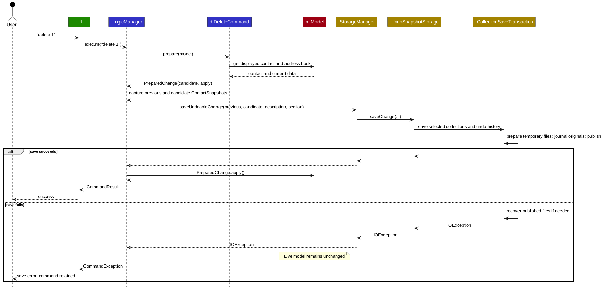
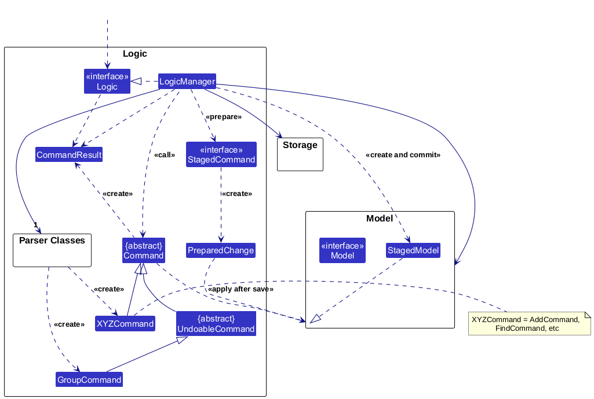
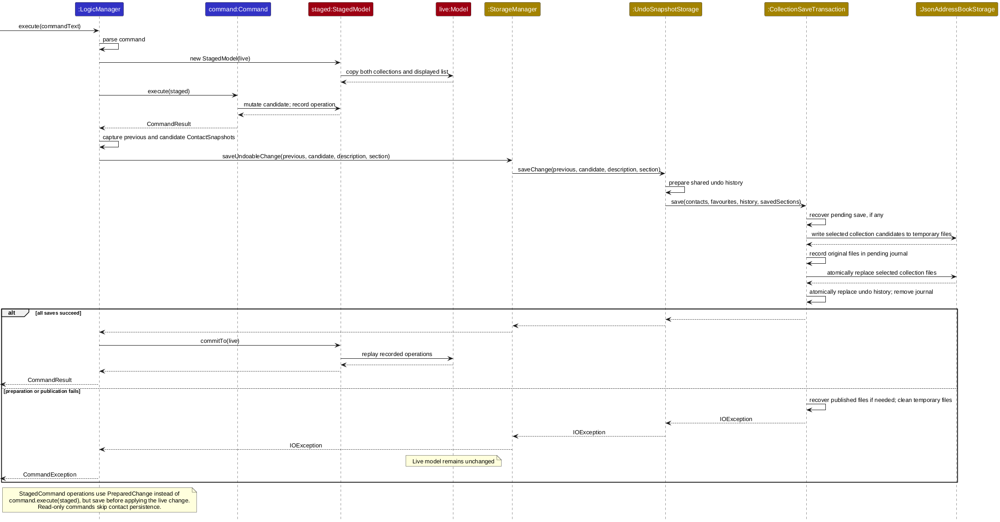
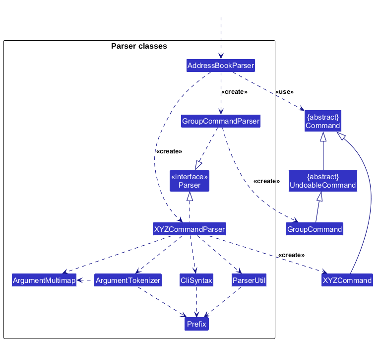
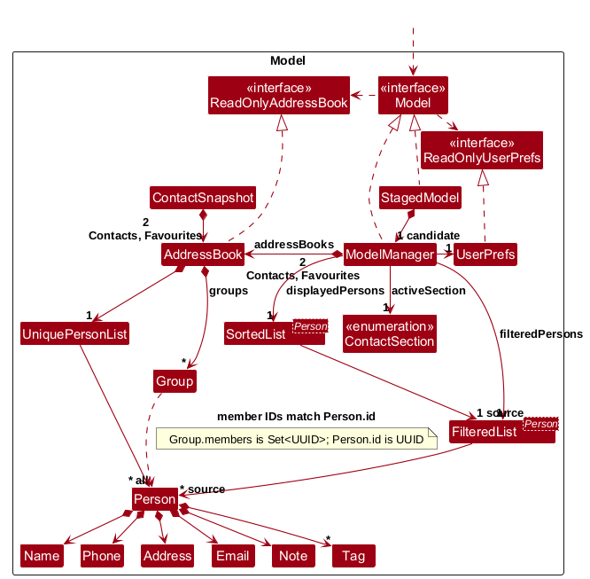
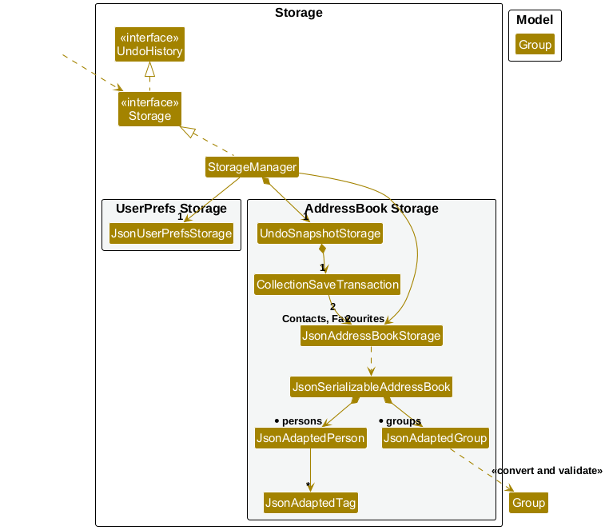
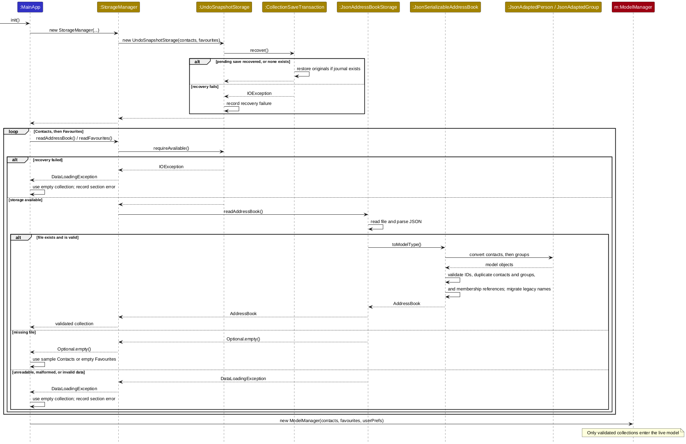
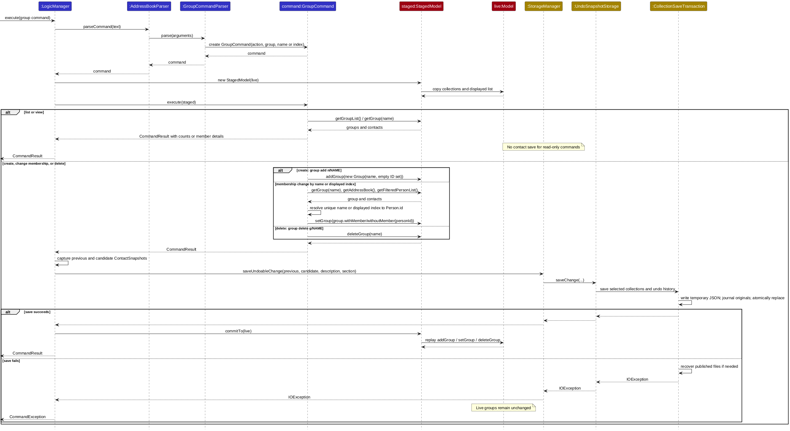

* Table of Contents
{:toc}

--------------------------------------------------------------------------------------------------------------------

## **Acknowledgements**

* _{List the sources of reused or adapted ideas, code, documentation, and third-party libraries here, with links to the originals.}_

--------------------------------------------------------------------------------------------------------------------

## **Setting up, getting started**

Refer to the guide [_Setting up and getting started_](SettingUp.md).

--------------------------------------------------------------------------------------------------------------------

## **Design**

<div markdown="span" class="alert alert-primary">

:bulb: **Tip:** The `.puml` files used to create diagrams are in `docs/diagrams`. Refer to the [_PlantUML Tutorial_ at se-edu/guides](https://se-education.org/guides/tutorials/plantUml.html) to learn how to create and edit diagrams.
</div>

### Architecture


The ***Architecture Diagram*** given above explains the high-level design of the App.

The following provides a quick overview of the main components and their interactions.

**Main components of the architecture**

**`Main`** (consisting of classes [`Main`](https://github.com/se-edu/addressbook-level3/tree/master/src/main/java/seedu/address/Main.java) and [`MainApp`](https://github.com/se-edu/addressbook-level3/tree/master/src/main/java/seedu/address/MainApp.java)) is in charge of the app launch and shut down.
* At app launch, it initializes the other components in the correct sequence, and connects them up with each other.
* At shut down, it shuts down the other components and invokes cleanup methods where necessary.

The bulk of the app's work is done by the following four components:

* [**`UI`**](#ui-component): The UI of the App.
* [**`Logic`**](#logic-component): The command executor.
* [**`Model`**](#model-component): Holds the data of the App in memory.
* [**`Storage`**](#storage-component): Reads data from, and writes data to, the hard disk.

[**`Commons`**](#common-classes) represents a collection of classes used by multiple other components.

**How the architecture components interact with each other**

The *Sequence Diagram* below shows how the components interact with each other for the scenario where the user issues the command `delete 1`.



Each of the four main components (also shown in the diagram above),

* defines its *API* in an `interface` with the same name as the Component.
* provides its functionality through a concrete `{Component Name}Manager` class that implements the corresponding API interface.

For example, the `Logic` component defines its API in `Logic.java` and implements it in `LogicManager.java`. Other components interact with a component through its interface rather than its concrete class, preventing them from coupling to that component's implementation, as illustrated in the following partial class diagram.


The sections below give more details of each component.

### UI component

The **API** of this component is specified in [`Ui.java`](https://github.com/se-edu/addressbook-level3/tree/master/src/main/java/seedu/address/ui/Ui.java)


The UI consists of a `MainWindow` and its parts, such as `CommandBox`, `ResultDisplay`, `PersonListPanel`, and `StatusBarFooter`. All of these, including `MainWindow`, inherit from the abstract `UiPart` class, which captures common behavior among classes that represent visible GUI parts.

`CommandBox` uses `CommandHistory` to record non-empty commands submitted during the current application session and to navigate them with the Up and Down arrow keys. Submitted commands and the unfinished draft are kept in memory only. This history belongs to the UI component because it records command input rather than address-book data; it does not pass through `Logic`, `Model`, or `Storage`.

The `UI` component uses the JavaFX UI framework. The layouts of these UI parts are defined in matching `.fxml` files in `src/main/resources/view`. For example, [`MainWindow.fxml`](https://github.com/se-edu/addressbook-level3/tree/master/src/main/resources/view/MainWindow.fxml) specifies the layout of [`MainWindow`](https://github.com/se-edu/addressbook-level3/tree/master/src/main/java/seedu/address/ui/MainWindow.java).

The `UI` component,

* executes user commands using the `Logic` component.
* listens for changes to `Model` data so that the UI can be updated with the modified data.
* keeps a reference to the `Logic` component, because the `UI` relies on the `Logic` to execute commands.
* depends on some classes in the `Model` component because it displays `Person` objects from the model.

`MainWindow.refreshActiveSection` updates the active-section label, rebinds `PersonListPanel` to the selected collection's filtered list, and updates the footer's save path after successful commands. Section switching is command-only; the label does not handle clicks.

### Logic component

**API** : [`Logic.java`](https://github.com/se-edu/addressbook-level3/tree/master/src/main/java/seedu/address/logic/Logic.java)

Here's a (partial) class diagram of the `Logic` component:



The sequence diagram below illustrates the interactions within the `Logic` component, taking `execute("delete 1")` API call as an example.


<div markdown="span" class="alert alert-info">:information_source: **Note:** The lifeline for `DeleteCommandParser` should end at the destroy marker (X), but due to a limitation of PlantUML, it continues to the end of the diagram.
</div>

How the `Logic` component works:

1. When `Logic` is called upon to execute a command, the command is passed to an `AddressBookParser` object, which in turn creates a parser that matches the command (e.g., `DeleteCommandParser`) and uses it to parse the command.
1. This results in a `Command` object (more precisely, an object of one of its subclasses e.g., `DeleteCommand`) which is executed by the `LogicManager`.
1. Commands without the `StagedCommand` capability execute against a `StagedModel`, which copies both collections and records model operations. Commands implementing `StagedCommand`, such as deletion, return a `PreparedChange` instead.
1. If the command changes contacts or groups, `LogicManager` saves the candidate collections and shared undo history before applying changes to the live model. If saving fails, the candidate is discarded and a `CommandException` is thrown. Commands that only change the view or active section do not save contact data.
1. After committing, the `CommandResult` is returned to the UI. The persistence flow is shown below.



Here are the other classes in `Logic` (omitted from the class diagram above) that are used for parsing a user command:



How the parsing works:
* When called upon to parse a user command, the `AddressBookParser` class creates an `XYZCommandParser` (`XYZ` is a placeholder for the specific command name, e.g., `AddCommandParser`). The parser uses the other classes shown above to parse the user command and create an `XYZCommand` object (e.g., `AddCommand`). The `AddressBookParser` returns that object as a `Command` object.
* All command parsers, including `GroupCommandParser`, implement the `Parser` interface so they can be treated similarly where appropriate, for example during testing.

### Model component
**API** : [`Model.java`](https://github.com/se-edu/addressbook-level3/tree/master/src/main/java/seedu/address/model/Model.java)




The `Model` component,

* stores independent Contacts and Favourites address books, keyed by `ContactSection`, each with its own `UniquePersonList` of `Person` objects and groups whose members are identified by contact ID.
* maintains `FilteredList<Person>` and `SortedList<Person>` views backed by the active address book's person list. It exposes the displayed view as an unmodifiable `ObservableList<Person>` that the UI can observe and bind to, so the UI updates when the source list, filter, or ordering changes.
* stores a `UserPrefs` object that represents the user’s preferences (currently, just the GUI settings). This is exposed to the outside as a `ReadOnlyUserPrefs` object.
* does not depend on any of the other three components (as the `Model` represents data entities of the domain, they should make sense on their own without depending on other components)

`getAddressBook()` and ordinary contact operations use the active section; `getAddressBook(section)` reads a specific complete collection. Switching sections rebuilds the active filtered view and shows all contacts. Selecting the current section preserves its filter. GUI preferences remain shared across sections.

<div markdown="span" class="alert alert-info">:information_source: **Note:** The alternative, arguably more object-oriented, design below keeps a unique list of tags in `AddressBook`, and each `Person` references tags from that list. This lets `AddressBook` maintain one `Tag` object per unique tag instead of each `Person` holding its own `Tag` objects.<br>


</div>


### Storage component

**API** : [`Storage.java`](https://github.com/se-edu/addressbook-level3/tree/master/src/main/java/seedu/address/storage/Storage.java)



The `Storage` component,

* saves Contacts, Favourites, and user preferences in JSON format, and reads them back into corresponding objects.
* is implemented by `StorageManager`, which uses separate `JsonAddressBookStorage` instances for `data/addressbook.json` and `data/favourites.json`, and `JsonUserPrefsStorage` for preferences. `UndoSnapshotStorage` coordinates the shared undo history and uses `CollectionSaveTransaction` to save both collections and the history consistently. Both contact files use the existing address-book JSON schema.
* depends on some classes in the `Model` component (because the `Storage` component's job is to save/retrieve objects that belong to the `Model`)

At startup, `UndoSnapshotStorage` recovers any interrupted save before `MainApp` loads each collection through `StorageManager`. JSON values, duplicate IDs and contacts, and group membership references are validated before `ModelManager` is created:



### Common classes

Classes used by multiple components are in the `seedu.address.commons` package.

--------------------------------------------------------------------------------------------------------------------

## **Implementation**

This section describes some noteworthy details on how certain features are implemented.

### Finding contacts

`FindCommandParser` trims the arguments, rejects an empty query, splits the query at whitespace, and creates a `PersonContainsKeywordsPredicate`. `FindCommand` passes that predicate to `Model.updateFilteredPersonList`, which applies it to the complete person list of the active section.

The predicate combines all keywords and searchable fields with OR semantics. Name matching is a case-insensitive substring test, so partial names match. A tag must equal a keyword ignoring case. Notes use `StringUtil.containsWordIgnoreCase`, which splits the stored note only at whitespace and compares complete tokens ignoring case; punctuation therefore remains part of a note token.

Each `find` replaces any existing filter rather than searching only the contacts currently displayed. `ModelManager.updateFilteredPersonList` also clears the `SortedList` comparator, so invoking `find` intentionally switches away from Recent ordering and displays matching contacts in their underlying insertion order. No additional sequence diagram is needed because this follows the standard parser → command/predicate → model flow.

### Duplicate detection

`Person.isSamePerson` defines contact identity: two contacts conflict when either their non-empty phone numbers match or their non-empty email addresses match. Names are not identity fields, so same-name contacts are allowed when both identity fields differ. The non-empty checks are defensive; normal `add` and `edit` input validation requires valid phone and email values.

`AddressBook` delegates uniqueness enforcement to `UniquePersonList`. Its `add`, `setPerson`, and bulk replacement paths use `Person.isSamePerson`, so the invariant also applies when a collection is loaded from storage. `EditCommand` checks the proposed contact with `hasPersonOtherThan`, which excludes the target contact itself but compares against every other contact. Both Add and Edit inspect the complete active collection through the model, not only the displayed `FilteredList`.

`AddCommand` scans all conflicts before mutation and classifies them for user feedback: phone only, email only, both fields matching the same contact, or phone and email matching two different contacts. `EditCommand` reports its single duplicate-contact message for any identity conflict. Through `LogicManager`, command execution first uses a staged candidate; a duplicate is rejected before any staged mutation, save, undo-history registration, or commit to the live model.

### Recently added contacts

The insertion order of each `AddressBook` person list is the source of truth for recency. There is no timestamp, last-modified field, or additional JSON schema field. `ModelManager` wraps the active collection's observable person list in a `FilteredList` and then a `SortedList`. `recent` shows all contacts and installs a comparator that orders their source-list indices from highest to lowest, producing newest-added-first display order without changing the stored list.

Add appends to the source list, so a new contact appears first while Recent remains active. Edit replaces a contact at the same source index, and Delete removes one entry, so both preserve the relative recency of the remaining contacts. Intentional view-changing commands such as `list`, `find`, and `filter` clear the Recent comparator; switching contact sections rebuilds the displayed view as well.

`JsonSerializableAddressBook` writes and reconstructs the `persons` array in list order, so insertion order survives persistence and restart. The active Recent view is UI/model state and is not persisted: startup initially displays the stored addition order, and the user invokes `recent` again to restore newest-added-first display.

### Contact deletion (F4)

`DeleteCommandParser` checks argument count, then delegates ASCII positive-integer validation to `ParserUtil.parsePositiveInteger`. A `BigInteger` retains oversized inputs until empty-list and range validation; conversion to an `int` occurs only after checking the displayed count.

`DeleteCommand` extends `UndoableCommand` and implements `StagedCommand`. Its `prepare` method resolves the displayed index once and returns a `PreparedChange`: a full candidate collection, an operation capturing the selected contact, success feedback, and the save-error message. `LogicManager` saves the candidate before applying that operation. Deletions in either section register a shared undo snapshot. It depends on the staging interface, not a concrete deletion command. A failed save produces no observable live-model changes. Both staging paths require synchronous execution without intervening commands.

The existing duplicate rules remain owned by contact creation. Deletion removes the selected contact object; it does not search by name. Notes are part of that immutable contact, and other contacts retain their own tags and notes.

`CommandBox` clears input only after successful execution and retains it when parsing or execution throws. `PersonListPanel` provides the empty-list placeholder and updates card numbering when cell indices change.

`DeleteUiTest` checks the empty-list label, renumbered cells, and command-input behavior on the JavaFX application thread. Run it with `./gradlew test --tests '*DeleteUiTest'` on a machine with a graphical display. It is skipped on Linux when `DISPLAY` is absent; logic/storage tests remain independent of the display.

The persistent contact-details panel is owned by the view feature and is not yet implemented: `view` currently writes details into the feedback box. Clearing details for the deleted contact, preserving another contact's details, and retaining details on failure remain integration acceptance criteria for that owner. F4 does not add a competing panel.

### Viewing a contact

`ViewCommandParser` requires exactly one argument and parses it as a positive index via `ParserUtil.parseIndex`. Invalid formats surface as `ParseException` with the `view` usage message.

`ViewCommand` does not mutate contacts or trigger a save. It reads `Model#getFilteredPersonList()`, so the index refers to the currently displayed list (including results after `find` or `filter`). An empty displayed list or an out-of-range index raises `CommandException`. On success, it formats the selected contact's fields, tags, and optional note into a `CommandResult` shown in the result box.

The sequence diagram below shows the interactions within the `Logic` component for `execute("view 1")`.


<div markdown="span" class="alert alert-info">:information_source: **Note:** The lifeline for `ViewCommandParser` should end at the destroy marker (X), but due to a limitation of PlantUML, it continues to the end of the diagram.

</div>

### Command history

`CommandHistory` records every non-empty command submitted from `CommandBox`, including commands that later fail parsing or execution. Recording occurs before `CommandExecutor.execute` is called. Therefore, a user can recall and correct an invalid command instead of typing it again. Empty input is ignored and is not added to history.

Each `CommandHistory` maintains:

* a `List<String>` containing the commands available for navigation during the current session;
* a `commandDraft` containing unfinished input saved when history navigation starts; and
* a `nextCommandIndex` identifying the current navigation position.

When a command is added, `CommandHistory` adds it to the in-memory list and moves `nextCommandIndex` to the position immediately after the newest command. This reset ensures that pressing Up after submitting a new command recalls that new command, even if the user had previously navigated to an older entry.

`CommandBox` handles navigation on JavaFX `KEY_PRESSED` events:

* When the user first presses Up, `getPreviousCommand` saves the text in the command box as the draft, moves the index toward the beginning of the list, and returns the older command.
* When the user presses Down, `getNextCommand` moves the index toward the end of the list and returns either the newer command or the saved draft after the newest command.
* `CommandBox` replaces the input text with the returned command and places the caret at the end of that text.
* If the index is already at the oldest command or past the newest entry, the corresponding method returns an empty `Optional`; the input remains unchanged.

The arrow-key event is consumed after history navigation so the `TextField` does not also apply its default key behavior. Other key events are left untouched.

Command history remains only in memory. It does not pass through the `Storage` component or create a temporary history file, so neither a normal shutdown nor an abnormal process exit leaves a command-history file containing submitted commands. Every launch starts with an empty history.

`CommandHistoryTest` verifies navigation order and boundaries, draft restoration, cursor reset after a new command, defensive checks, and the absence of a readable history file after an abnormal subprocess exit. `CommandHistoryUiTest` verifies the Up and Down key bindings, caret placement, draft restoration, and retention of a failed command on the JavaFX application thread. Run them with `./gradlew test --tests '*CommandHistoryTest' --tests '*CommandHistoryUiTest'`. The UI test is skipped on Linux when `DISPLAY` is absent; the non-UI history tests remain independent of the display.

### Automatic contact persistence (F5)

`LogicManager` executes commands without the `StagedCommand` capability once against `StagedModel`. The candidate holds both complete collections and uses a snapshot of the visible contacts for indexed operations. It records contact, group, view, and preference changes. Contact mutations identify the initiating section, though linked Favourites changes may also affect the other collection. `LogicManager` captures the previous and candidate states of both collections, then asks `StorageManager` to save them with the shared undo history. Identical data still saves without adding an undo entry. View-only commands do not save contact data. The current UI runs commands synchronously, so the live model remains unchanged between preparing and committing a command.

After saving, recorded operations are applied to the live model. This preserves incremental list
notifications instead of replacing the whole list for every change. A deletion leaves the live search
predicate active. A rejected command or failed save emits no changes to the live list, preserving UI
selection and the input command. The UI displays success only after `LogicManager.execute` returns.

`UndoSnapshotStorage` uses `CollectionSaveTransaction` to prepare both selected collection files and the shared undo-history file. The transaction records original file bytes in a pending journal before publishing the candidates with atomic replacement. If publication fails or the app stops mid-save, recovery restores the selected originals before either collection is loaded again. A section whose file failed to load is excluded from an unrelated save, preserving that invalid file for inspection. `JsonAddressBookStorage` writes each collection candidate to a temporary file beside its destination and rejects saves if atomic replacement is unavailable.

`MainApp` loads both collections independently and always starts on Contacts. A missing Contacts file uses sample contacts; a missing Favourites file uses an empty collection. Loading distinguishes unreadable files, malformed JSON, and invalid contact values. Conversion validates a whole collection before exposing its contacts. A load error starts only the affected collection empty, and `UiManager` reports its section and path after the window opens. If both files fail, both errors are reported. Existing files remain untouched until a command successfully saves a replacement for that collection.

Group commands use the same staged save path. `GroupCommandParser` parses creation, listing, viewing, membership changes, and deletion into `GroupCommand` actions. Membership commands resolve a unique contact name or a displayed index to a persistent contact ID; ambiguous names require an index. Listing and viewing are read-only. The candidate address book stores `Group` objects with member IDs, which `JsonAdaptedGroup` writes and validates on restore. Legacy name-based memberships are migrated while loading:



Integration with the other MVP features:

* `JsonAdaptedPerson` saves basic contact fields, tags, and notes. Older files without a note load with
  an empty note. Conversion uses the same model validation and duplicate rules as contact commands.
* `view` reads the staged contacts without writing a file. UI updates occur after a successful
  `CommandResult`; commands do not directly change UI controls or write storage files.
* `find` and `list` update the view through `Model.updateFilteredPersonList`. Storage always receives
  the full address book, never just the displayed results.
* `edit` supports the final `note/` argument with the same parsing and validation as `add`. Other edits
  retain the existing note. A failed save leaves the original note and tags untouched.
* Any new Model mutation must also be implemented and recorded by `StagedModel`. Keep `Person` immutable
  so copying the collection safely isolates candidate changes. Staging copies both visible membership
  and display order, so indexed commands also resolve correctly after `recent`.

### Favourites and section switching

`TabCommandParser` accepts exactly `contacts` or `favourites` after trimming surrounding whitespace. `TabCommand` calls `Model.setActiveSection` through staging. This changes the visible collection without marking contact data as changed, so navigation remains available when saving fails. Existing commands keep using the active collection through the `Model` interface. The prepared deletion path saves the candidate through the shared transaction.

`FavouriteCommandParser` delegates index validation to `ParserUtil.parsePositiveInteger`, retaining a `BigInteger` until the displayed-list range check passes. Missing, extra, or malformed arguments produce the favourite usage message. Execution then validates the active section, empty-list condition, index range, and duplicate identity, in that order.

`FavouriteCommand` selects from the displayed Contacts list and calls `Model.addFavourite`. This appends to Favourites without changing the active section or filter. `StagedModel.getChangedSection()` identifies Favourites as the destination even though Contacts stays active. `LogicManager` saves both candidate collections and shared history before replaying the append on the live model. Failed saves leave both collections, files, and observable lists unchanged.

Duplicate detection uses `Person.isSamePerson`: matching phone numbers or email addresses. Both files store full contact records with persistent IDs, without a favorite flag. Linked Favourites retain the original contact ID, allowing edits and deletions in Contacts to update the corresponding Favourite. `Person` is immutable, so copying its value is safe. Removing a Favourite uses the existing `delete` command while Favourites is active.

The favourites cases in `LogicManagerTest` cover copying a displayed contact, duplicate and selection errors, wrong-section errors, save failure, and context switching with contact commands scoped to the selected collection. `AddressBookParserTest` checks the `favourite` and `tab` command formats. Broader regression testing is deferred to the next milestone. Use the manual scenarios below to verify visible feedback and command-input behavior.

### Undo history

The `undo` command restores both Contacts and Favourites to their state before the most recent successful data change. It works from either active section. A single shared history keeps at most five snapshots and persists across restarts; redo is not implemented.

#### Recording changes

`LogicManager` captures complete `ContactSnapshot` values before and after a mutation. An `UndoableCommand` supplies operation-specific feedback; other data changes receive generic undo feedback. `StorageManager.saveUndoableChange` delegates to `UndoSnapshotStorage`, which compares both collections and adds a history entry only when their data changed. Each entry contains both complete collections and a description. When a sixth entry is added, the oldest is removed.

`CollectionSaveTransaction` publishes the candidate collections and bounded shared history as one recoverable operation. A pending journal stores original file bytes until publication finishes. A rejected command or failed save leaves the live model and prior history unchanged. View-only commands do not save or consume history.

#### Restoring a snapshot

The model-level `UndoHistory` interface exposes `readLatestSnapshot()`, `saveRestoredSnapshot()`, and `discardLatestSnapshot()` without depending on logic or storage classes. `Storage` extends that interface, and `StorageManager` owns one shared `UndoSnapshotStorage`. `LogicManager` supplies history to `AddressBookParser`, which passes the narrow interface through `UndoCommandParser` to `UndoCommand`. Parsing does not access history.

`UndoCommand` implements `StagedCommand` and owns undo behavior:

1. `prepare(model)` reads the latest snapshot without consuming it. Empty history produces `No changes to undo.`; unreadable or invalid history produces the load-error message.
1. The command returns a `PreparedChange` containing the snapshot, operation-specific feedback, and an operation to apply after saving.
1. The staged-command path saves the restored collections and remaining history using `UndoHistory.saveRestoredSnapshot()`. A failed save leaves the model, displayed results, files, and history unchanged.
1. After saving succeeds, the prepared operation replaces both model collections, shows all contacts in each, restores the original active section, and consumes the in-memory history entry.

`UndoCommand` does not extend `UndoableCommand`, so restoration creates no new history entry. `LogicManager` needs no undo-specific execution branch, and `CommandResult` contains ordinary feedback. Preparation, saving, and application must run synchronously without intervening commands. Callers must use the logic execution path for persistence; directly calling a staged command's `execute` bypasses the save step.

#### Backup lifecycle and design tradeoffs

`UndoSnapshotStorage` keeps the five-entry history in a shared JSON file beside the Contacts file. Checksums tie it to the saved Contacts and Favourites bytes; externally changed files cause stale history to be ignored. Its transaction journal allows recovery from an interrupted save before either collection loads. `MainApp.stop()` closes the storage session without deleting persistent history.

Full snapshots avoid command-specific inverse operations and restore contact order, IDs, groups, tags, and notes together. Search predicates and GUI preferences are outside snapshots; successful undo deliberately shows all contacts.

### \[Proposed\] Data archiving

_{Explain here how the data archiving feature will be implemented}_


--------------------------------------------------------------------------------------------------------------------

## **Documentation, logging, testing, dev-ops**

* [Documentation guide](Documentation.md)
* [Testing guide](Testing.md)
* [Logging guide](Logging.md)
* [DevOps guide](DevOps.md)

--------------------------------------------------------------------------------------------------------------------

## **Appendix: Requirements**

### Product scope

**Target user profile**: ***NUS Student***

* has a need to organise and categorise a large number of contacts acquired through various settings, such as hackathons, networking events, and school activities.
* needs the flexibility to store contacts using different types of information, such as email addresses or phone numbers, while allowing for missing information.
* needs a way to record additional context about contacts, such as details from previous conversations or interactions.
* prefers desktop apps over other types of applications
* can type fast
* prefers typing to mouse interactions
* is reasonably comfortable using CLI apps

**Value proposition**: 

* manages contacts faster than with a typical mouse-driven GUI application.
* enables categorisation of contacts by creating tags, allowing NUS students to group large number of contacts into meaningful groups. This is especially important given that NUS students meet many people through various settings like hackathons and CCAs.
* enables filtering and searching of contacts via tags, making it easier to find relevant contacts without remembering their details exactly.
* supports storing of multiple types of contact information, such as email addresses and phone numbers, for flexible contact management.
* allows storing of additional context about contacts, such as details from previous conversations and interactions.


### User stories

Priorities: High (must have) - `* * *`, Medium (nice to have) - `* *`, Low (unlikely to have) - `*`

| Priority | As a …​                                    | I want to …​                     | So that I can…​                                                        |
| -------- | ------------------------------------------ | ------------------------------ | ---------------------------------------------------------------------- |
| `* * *`  | new user                                   | see usage instructions         | refer to instructions when I forget how to use the App                 |
| `* * *`  | student                                       | add a new person               | record someone I want to remember or contact later                     |
| `* * *`  | student                                       | store different types of contact information, such as phone numbers and email addresses               | contact people through different methods                                                                       |
| `* * *`  | student                                   | add a contact even when some contact information is unavailable         | save useful contacts without needing complete information                 |
| `* * *`  | student                                       | delete a person                | remove entries that I no longer need                                   |
| `* * *`  | student                                       | edit a contact's information                | keep their details and notes up to date                                   |
| `* * *`  | student                                       | find a person by name          | locate details of persons without having to go through the entire list |
| `* *`      | student with many persons in the address book | categorise contacts           | organise the large number of contacts I meet through different situations                                              |
| `* *`      | student with many persons in the address book | filter contacts by their categories           | quickly find contacts relevant to a particular context, such as a hackathon or school activity                                              |
| `* *`      | student | add notes to a contact          | record additional context, such as what we previously discussed or where we met                                              |
| `*`      | student with many persons in the address book | sort persons by name           | locate a person easily                                                 |
| `*`      | student | view a summary of all tags used across my contacts           | quickly understand how my contacts are categorised and identify relevant groups                                                 |
| `* * *`      | student who prefers keyboard-driven tools | manage contacts using commands | work quickly without switching between forms |
| `*`      | student | view all contacts in a tag | manage related people together |
| `*`      | student | export my local data | keep a backup |
| `*`      | student | undo my most recent contact-management action | quickly recover from accidental changes |
| `*`      | student | have the application warn me about possible duplicate contacts | avoid accidentally storing the same person multiple times |
| `*`      | student | remove outdated tags from a contact | ensure their stored information remains relevant |
| `*`      | student | search contacts using partial names | find someone even when I do not remember their full name |
| `*`      | student | combine multiple search filters | narrow down a large list of contacts precisely |
| `*`      | student | sort contacts by fields such as name or organisation | browse my contacts in a useful order |
| `*`      | student | mark important contacts as favourites | access frequently contacted people quickly |
| `*`      | student | view recently added contacts | quickly find people I met recently |
| `*`      | student | record when I last contacted someone | know how recently we have communicated |
| `*`      | student | store useful links such as LinkedIn, GitHub, or Telegram profiles for a contact | quickly access their online profiles |
| `* *`      | student | add or remove contacts from an existing group | allow group membership to change as projects and organisations evolve |
| `*`      | student | rename a group | update it when a project or team changes its name |
| `* * *`  | student | search using remembered details, such as an event and a skill | find someone even when I have forgotten their name |
| `* * *`  | student | be told what is wrong when a command is invalid | correct the command and try again |
| `* *`    | student | place contacts into groups | organise project teams and student organisation members |
| `* *`    | student | view all contacts in a group | manage related people together |
| `* *`    | student | see which groups a contact belongs to | understand how I know them |
| `* *`    | student | store when a contact is usually available | coordinate with that person more easily |
| `* *`    | student | find common free periods among contacts in a group | arrange a project meeting in less time |
| `*`      | project team leader | find common free periods among team members | arrange meetings quickly |
| `*`      | student applying for jobs | tag contacts as recruiters, referrers, or interviewers | keep track of my professional network |
| `*`      | student leader | group contacts by committee | manage members who work on the same events |
| `*`      | research student | tag collaborators and professors | keep track of them for outreach |

### Use cases

(For all use cases below, the **System** is the `AddressBook` and the **Actor** is the `user`, unless specified otherwise)

**Use case: Delete a person**

**MSS**

1.  User requests to list persons
2.  AddressBook shows a list of persons
3.  User requests to delete a specific person in the list
4.  AddressBook deletes the person

    Use case ends.

**Extensions**

* 2a. The list is empty.

  Use case ends.

* 3a. The given index is invalid.

    * 3a1. AddressBook shows an error message.

      Use case resumes at step 2.

**Use case: Add a person**

**MSS**

1.  User requests to add a person, providing a name, contact information, and any relationship context
2.  AddressBook adds the person

    Use case ends.

**Extensions**

* 1a. The name is missing, or neither a phone number nor an email address is provided.

    * 1a1. AddressBook shows an error message.

      Use case ends.

* 1b. The supplied phone number or email address matches a person already stored.

    * 1b1. AddressBook shows an error message.

      Use case ends.

* 1c. A supplied value does not meet the expected format.

    * 1c1. AddressBook shows an error message.

      Use case ends.

**Use case: Find a person by remembered details**

**MSS**

1.  User requests to find persons using one or more remembered keywords
2.  AddressBook shows the matching persons
3.  User requests the details of a specific person in the results
4.  AddressBook shows that person's details

    Use case ends.

**Extensions**

* 2a. No person matches the keywords.

  Use case ends.

* 3a. The given index is invalid.

    * 3a1. AddressBook shows an error message.

      Use case resumes at step 2.

**Use case: View a person**

**MSS**

1.  User requests to list persons
2.  AddressBook shows a list of persons
3.  User requests to view a specific person in the list
4.  AddressBook shows that person's details

    Use case ends.

**Extensions**

* 2a. The list is empty.

  Use case ends.

* 3a. The request does not give exactly one positive index.

    * 3a1. AddressBook shows an error message.

      Use case resumes at step 2.

* 3b. The given index is not in the list.

    * 3b1. AddressBook shows an error message.

      Use case resumes at step 2.

**Use case: Edit a person**

**MSS**

1.  User requests to list persons
2.  AddressBook shows a list of persons
3.  User requests to change one or more details of a specific person in the list
4.  AddressBook updates the person

    Use case ends.

**Extensions**

* 2a. The list is empty.

  Use case ends.

* 3a. The given index is invalid.

    * 3a1. AddressBook shows an error message.

      Use case resumes at step 2.

* 3b. The user does not specify any detail to change.

    * 3b1. AddressBook shows an error message.

      Use case resumes at step 2.

* 3c. A supplied value does not meet the expected format.

    * 3c1. AddressBook shows an error message.

      Use case resumes at step 2.

**Use case: Favourite a contact**

**MSS**

1. User selects Contacts and lists or searches for contacts.
1. AddressBook displays the matching contacts with indices.
1. User requests to favourite a displayed contact by index.
1. AddressBook saves an independent copy in Favourites and confirms success, keeping Contacts and its current search selected.

Use case ends.

**Extensions**

* 3a. The index is malformed, missing, or outside the displayed list, or the list is empty.

  AddressBook reports the error and retains the entered command. No data changes.

* 3b. A contact with the same phone number or email address already exists in Favourites.

  AddressBook reports that the contact is already in Favourites. The existing copy is preserved.

* 3c. The user makes the request while Favourites is active.

  AddressBook reports that the user must switch to Contacts to favourite a contact.

* 4a. Saving Favourites fails.

  AddressBook reports a save error and retains both files, live collections, and entered command unchanged.

**Use case: Add a person to a group**

**MSS**

1.  User requests to list persons
2.  AddressBook shows a list of persons
3.  User requests to add a specific person to a group
4.  AddressBook records that person as a member of the group

    Use case ends.

**Extensions**

* 2a. The list is empty.

  Use case ends.

* 3a. The given index is invalid.

    * 3a1. AddressBook shows an error message.

      Use case resumes at step 2.

* 3b. The named group does not exist.

    * 3b1. AddressBook shows an error message.

      Use case resumes at step 2.

### Non-Functional Requirements

The following requirements apply to AB4, the contact manager for NUS students described in the [README](../README.md). They describe the intended product, including requirements that may be implemented after this semester; they are not a statement that the current version satisfies every requirement.

1. **Portability:** AB4 shall run as a standalone desktop application on Windows, macOS, and Linux with only Java `25` installed; compatible JavaFX native libraries shall be bundled. The same release JAR and contact data format shall be usable across these operating systems without changes to application code.
2. **Installation:** After installing the required Java runtime, a user shall be able to launch AB4 from its release JAR without installing a separate database server or application server, or obtaining administrator privileges. The application folder and data location must be writable by the user.
3. **Offline operation:** All contact-management operations shall work without an Internet connection or an online account, including adding, viewing, editing, finding, deleting, saving, and loading contacts and their relationship context.
4. **Capacity:** AB4 shall support at least 1,000 contacts in one address book while meeting the performance requirements below. The evaluation dataset shall include, per contact, a name, phone number, email address, postal address, up to 10 tags of up to 30 characters each, and a note of up to 1,000 characters. These sizes define the evaluation workload, not input validation limits.
5. **Performance:** With the capacity dataset above, at least 95 of 100 consecutive contact-management commands shall display their result within 2 seconds of pressing Enter. Each run shall include adding, listing, viewing, editing, finding, and deleting contacts, with searches covering names, contact information, tags, and notes. Startup shall display the loaded contact list and accept input within 5 seconds. Measure these targets on a computer with at least two CPU cores, 8 GB RAM, and SSD storage, running one AB4 instance with no other resource-intensive applications active.
6. **Keyboard usability:** Typed commands shall be the primary input method, with the GUI providing visual feedback. All contact-management operations shall be completable using the keyboard without mouse interaction. Command results and validation errors shall be visible in the GUI. Invalid input messages shall identify the problem and provide the expected format or permitted values so that users can correct the command.
7. **Learnability:** In a usability evaluation, at least 4 out of 5 NUS students who are comfortable typing commands but have not used AB4 before shall be able to add a contact with relationship context, find that contact, and delete it within 10 minutes in total, using the User Guide without assistance from a facilitator.
8. **Persistence and data integrity:** Following a successful save, all contact fields, tags, and notes shall be preserved across normal shutdown and restart. Rejected commands shall leave contact data unchanged. A failed save or an unreadable or invalid existing data file shall produce a visible error and shall not silently overwrite the last saved data. A save interrupted by an application crash shall leave either the previous complete dataset or the new complete dataset available on disk, rather than a partially written dataset.
9. **Privacy:** AB4 shall store contact data locally and shall not transmit contact details, tags, notes, or entered commands to external services. Diagnostic logs shall not contain these values. Access to local data files is governed by the user's operating-system account and file permissions; this requirement does not imply encryption of the stored data.
10. **Data portability:** Copying a user's saved contact data file to their own computer on another supported operating system running the same AB4 release shall preserve all contact fields, tags, and notes without manual conversion. Contact data shall use a documented, UTF-8 JSON format. If a future release changes that format, it shall document a migration procedure that preserves existing valid data.
11. **Single-user operation:** AB4 shall serve one user, without shared-computer use by different people or routine sharing of data files between users.
12. **Editable storage:** Local JSON data shall remain directly editable in a text editor. Valid edits made while AB4 is closed shall load on restart, including changes to contacts, tags, and notes. The User Guide shall explain the file location, editing procedure, and validation risks, providing at least the editing support described in the [AB3 User Guide](https://se-education.org/addressbook-level3/UserGuide.html#editing-the-data-file). No database management system, including an embedded one, shall store application data.
13. **Distribution:** One JAR, at most 100 MB, shall contain all required dependencies and assets, with no installer or additional software installation beyond Java.
14. **Display compatibility:** The GUI shall avoid resolution-related inconvenience at 1920×1080 or higher with 100% and 125% scaling. All functions shall remain usable at 1280×720 or higher with 150% scaling.
15. **External dependencies:** Third-party dependencies shall be free and permissively licensed; libraries and frameworks shall also be open source.

These requirements incorporate the product constraints in the [course project constraints](https://nus-cs2103-ay2627-s1.github.io/website/admin/tp-constraints.html). Course development and approval obligations remain applicable separately.

### Glossary

* **Mainstream OS**: Windows, Linux, Unix, or macOS
* **Private contact detail**: A contact detail that is not meant to be shared with others
* **AB4**: The desktop contact manager for National University of Singapore (NUS) students developed in this project, based on AddressBook Level 3 (AB3)
* **Address book**: The collection of persons managed by one AB4 instance
* **Person**: A contact record about someone the user wants to remember or contact. In this guide, “person” does not mean the application user
* **Contact information**: Details used to reach a person, such as a phone number, email address, or postal address
* **Relationship context**: Information that helps the user remember how they know a person, such as a shared module, student organisation, project, or event. It can be recorded with tags and notes
* **Tag**: A short label attached to a person to categorise them or record shared context, such as `CS2103T` or `friend`. A person can have more than one tag
* **Note**: Free-text information attached to a person for relationship context that a short tag does not express
* **Group**: A named set of persons, such as a project team or a student-organisation committee. A person can belong to more than one group
* **Availability**: The periods when a person is usually free, stored so the user can coordinate with that person
* **User**: The person operating AB4. The target user is an NUS student who prefers typing commands
* **Index**: The positive integer shown next to a person in the current list. It identifies that person for the current list and is not a permanent identifier
* **MSS**: Main Success Scenario. The steps in a use case in which the actor achieves the intended outcome without taking an extension path

--------------------------------------------------------------------------------------------------------------------

## **Appendix: Instructions for manual testing**

Given below are instructions to test the app manually.

<div markdown="span" class="alert alert-info">:information_source: **Note:** These instructions only provide a starting point for testers to work on;
testers are expected to do more *exploratory* testing.

</div>

### Launch and shutdown

1. Initial launch

   1. Download the JAR file and copy it into an empty folder.

   1. Double-click the JAR file.<br>
      Expected: The GUI opens with a set of sample contacts. The window size may not be optimal.

1. Saving window preferences

   1. Resize the window to an optimal size. Move the window to a different location. Close the window.

   1. Relaunch the app by double-clicking the JAR file.<br>
       Expected: The most recent window size and location are retained.

1. _{ more test cases …​ }_

### Deleting a contact

Use disposable test contacts and a separate data file for these checks.

1. Create at least three contacts with different names, notes, and a shared tag. Delete the middle contact. Expect `Deleted contact: NAME (index 2).`, cleared input, consecutive numbering, and unchanged fields/tags/notes for the remaining contacts.
1. Search for a subset, delete its first result, and confirm contacts outside the search remain stored. Repeat `delete 1`: it selects the next result. Once results are empty, expect `No contacts to display.`; `delete 1` then reports the empty-list error.
1. Try `delete`, `delete abc 2`, `delete 01`, `delete +1`, `delete 1.0`, and a 100-digit positive index. Compare exact errors with the User Guide. Repeat on an empty search: count and format errors take priority over the empty-list error. Input remains available for correction.
1. Use spaces and tabs around `delete 1` and between keyword and index. Confirm acceptance. `Delete 1` is an unknown command; `delete 1 2` is rejected.
1. Restart after a successful deletion. Confirm the contact and its note remain absent and other contacts are restored unchanged.
1. Simulate a save failure using the integration tests in `LogicManagerTest`. They check partial writes, denied/unsupported replacement, original file bytes, unchanged model/filter, and zero observable notifications. For a manual check, make the disposable data directory unwritable, attempt deletion, and expect the exact save-error message with input and contacts retained; restore permissions and retry.

### Undoing contact changes

Use a disposable app folder with its own `data/addressbook.json` and `data/favourites.json`, since these checks change and restore both collections.

1. With at least two contacts present, run `add n/Undo Test p/91234567 e/undo@example.com a/NUS t/project note/Original note`, `edit 1 note/Changed note`, `delete 2`, and `clear`. Run `undo` four times. Each reports the operation being undone and restores the previous full collections, including order, tags, and notes. A fifth undo reports `No changes to undo.`. Check that successful commands clear input and failed commands retain it.
1. After a data change, run `find NoSuchUndoContact` to show no matches, then `undo`. Expect all restored contacts to be displayed. Make another change and undo it; confirm earlier history is still available afterward.
1. In a fresh session with a contact at index 1, use `edit 1 note/Step 1` through `edit 1 note/Step 6`. Five undos restore notes `Step 5` through `Step 1`; the sixth reports no history. The state before `Step 1` is no longer available.
1. In a fresh session, try `delete 0` and an edit that sets a field to its existing value. Neither creates undo history. After `clear`, issue `clear` again: a single undo restores the contacts; the next reports no history.
1. Enter `undo 1` and compare the exact usage message with the User Guide. `Undo` is an unknown command. Surrounding spaces and tabs around lowercase `undo` are accepted. Make a change in Favourites and run `undo` while Favourites is active; confirm that the Favourites change is reversed.
1. After a successful change, close and reopen the app. Confirm the change persists and `undo` can restore the state from before that change.
1. For a save-failure check, create a change, activate a search filter, then make the disposable data directory unwritable. Run `undo`: expect `Could not save changes. Nothing was undone. Please try again.`, unchanged contacts/search results/file contents, and retained input. Restore permissions and retry: the same snapshot remains available.
1. For a read-failure check, make one data change in a fresh session, then temporarily move the shared undo-history JSON file beside `data/addressbook.json`. Run `undo`: expect `Could not read undo history. Nothing was undone. Please try again.` and unchanged collections, search results, and data files. Return the history file to its original path and retry successfully. Do not edit a collection file while the app is running.

### Command history

1. Enter `list`, then enter `find Alex`. Press Up once and expect `find Alex`. Press Up again and expect `list`. Pressing Up again should leave `list` unchanged.
1. From `list`, press Down once and expect `find Alex`. Press Down again and expect the empty draft that was present before the first Up press. The caret should be at the end of each recalled command.
1. Type an unfinished command without pressing Enter. Press Up to recall the newest command, then press Down. Expect the unfinished command to be restored.
1. Enter an invalid command such as `notACommand`, press `Enter`, then replace it with `list`, and press Enter. Press Up to recall `list`, then press Up again. Expect `notACommand`, confirming that failed commands are also recorded.
1. Close and relaunch the application. With the command box empty, press Up and Down. Expect the input to remain empty, confirming that history from the previous launch was cleared.
1. Create a fresh, isolated temporary directory and launch the application with that directory configured as the JVM temporary directory (for example, using `-Djava.io.tmpdir=<path>`). Enter a command containing disposable contact details, then force-stop the application. Confirm that this launch creates no `addressbook-command-history-*.txt` file in the isolated directory and that relaunching the application provides no command from the terminated session. If an isolated directory cannot be used, compare the matching files in the shared temporary directory before and after the test and confirm that no new history file is created.

### Saving data

1. In a disposable launch folder with no data files, launch the app. Expect sample Contacts, an active Contacts label, and an empty Favourites section after `tab favourites`.
1. Add a contact directly in Favourites, restart, and run `tab favourites`. Expect the saved contact; startup itself still selects Contacts.
1. With the app closed, back up both contact files and replace `data/favourites.json` with malformed JSON. Relaunch. Expect an error naming Favourites and its path, an empty Favourites collection, and intact Contacts. Restore the backup before changing Favourites in the app.
1. Repeat with invalid Contacts data and valid Favourites data. Expect empty Contacts and intact Favourites. If both files are invalid, expect both errors. No startup load should overwrite either file.

### Favourites and section switching

Use a disposable launch folder. Prepare contacts with distinct names, tags, and notes; do not clear personal data for these checks.

1. Run `tab favourites` and `tab contacts`. Expect the section label, contact list, and footer file path to change together. Try `tab`, `tab other`, and `tab contacts favourites`; expect usage feedback, retained input, and no section change.
1. In Contacts, search for a contact that is not first in the full list, then run `favourite 1`. Expect the first displayed result to be copied, a success message with its name and displayed index, cleared input, and the same Contacts search still visible.
1. Run `tab favourites` and `view 1`. Expect the copied fields, tags, and note. Switching back to Contacts shows all contacts. Searching and then selecting the section that is already active preserves that search.
1. Repeat favouriting the same contact from Contacts, including after changing only its phone number while keeping its email address unchanged. Expect the duplicate error and no overwrite of the saved favorite. Run `favourite 1` in Favourites and expect the distinct wrong-section error. Both errors retain input.
1. In Contacts, try `favourite`, `favourite 1 2`, `favourite 01`, `favourite 0`, and a 100-digit positive index. Compare feedback with the User Guide. Search for a nonexistent name and try `favourite 1`; expect the empty-list error.
1. Edit or delete the original in Contacts. Expect its favorite copy to remain unchanged. Delete the copy in Favourites; expect the original, if still present, to remain. Favourite it again to confirm removal permits a new copy.
1. Exercise `add`, `edit`, `delete`, `clear`, `find`, `list`, and `view` in Favourites. Expect them to operate only on Favourites. Restart and verify that both files restore their respective collections and the active section starts on Contacts.
1. Use `LogicManagerTest` to check favourite save-error handling and the shared persistence failure cases. For manual feedback checks, make the disposable data location unwritable, attempt `favourite 1`, and expect the save-error message with input, files, and displayed data unchanged. Navigation and read-only commands must remain available; restore permissions before retrying.

Run the focused backend checks with:

```bash
./gradlew test --tests '*LogicManagerTest' --tests '*AddressBookParserTest'
```
