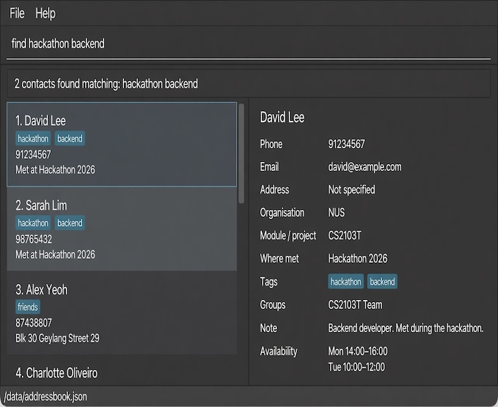

AB4 is a **desktop contact manager for NUS students, optimized for use through a Command Line Interface (CLI)** while retaining the benefits of a Graphical User Interface (GUI). It helps you keep contact details, tags, and notes locally and retrieve contacts by name or tag.

* Table of Contents
{:toc}

--------------------------------------------------------------------------------------------------------------------

## Quick start

1. Ensure that Java `25` or later is installed on your computer.<br> **Mac users:** Ensure you have the precise JDK version prescribed [here](https://se-education.org/guides/tutorials/javaInstallationMac.html).

1. Download `addressbook.jar` from the [AB4 releases page](https://github.com/AY2627S1-CS2103T-W11-3/tp/releases).

1. Copy the file to the folder you want to use as the _home folder_ for AB4.

1. Open a terminal, `cd` to the folder containing the JAR file, and run `java -jar addressbook.jar`.<br> A GUI similar to the one below should appear in a few seconds. Note how the app contains some sample data.<br>
   

1. Type a command in the command box and press Enter to execute it. For example, type **`help`** and press Enter to open the help window.<br> Some example commands you can try:

   * `list` : Lists all contacts.

   * `add n/John Doe p/98765432 e/johnd@example.com a/John street, block 123, #01-01` : Adds a contact named `John Doe` to the Address Book.

   * `delete 3` : Deletes the 3rd contact shown in the current list.

   * `clear` : Deletes all contacts.

   * `exit` : Exits the app.

   Press the Up arrow key to fill the command box with an earlier command. Press it repeatedly to move backward through
   commands entered during the current launch, and press the Down arrow key to move forward toward newer commands.
   Command history is cleared whenever AB4 is launched.

1. Refer to the [Features](#features) section below for details of each command.

--------------------------------------------------------------------------------------------------------------------

## Features

<div markdown="block" class="alert alert-info">

**:information_source: Notes about the command format:**<br>

* Words in `UPPER_CASE` are the parameters to be supplied by the user.<br> For example, in `add n/NAME`, replace `NAME` with a value such as `John Doe`.

* Items in square brackets are optional.<br> For example, `n/NAME [t/TAG]` can be used as `n/John Doe t/friend` or as `n/John Doe`.

* Items followed by `…`​ can appear zero or more times.<br> For example, `[t/TAG]…​` may be omitted, or written as `t/friend` or `t/friend t/family`.

* Prefixed fields in `add` and `edit` can be in any order, except that `note/NOTE` must be last. For indexed commands such as `edit`, put `INDEX` before the fields.<br> For example, `add p/91234567 n/John Doe e/john@example.com a/NUS note/Met in class` is valid.

* Extraneous parameters for commands that take no parameters, such as `help`, `list`, `exit`, and `clear`, are ignored.<br> For example, `help 123` is interpreted as `help`.

* If you are using a PDF version of this document, be careful when copying and pasting commands that span multiple lines as space characters surrounding line-breaks may be omitted when copied over to the application.
</div>

### Viewing help: `help`

Shows a message explaining how to access the help page.


Format: `help`

### Adding a person: `add`

Adds a person to the address book.

Format: `add n/NAME p/PHONE_NUMBER e/EMAIL a/ADDRESS [t/TAG]…​ [note/NOTE]`

<div markdown="span" class="alert alert-primary">:bulb: **Tip:**
A person can have any number of tags, including zero.
</div>

The optional `note/` prefix is case-insensitive and must be the final prefix in the command. Notes are trimmed and must contain 1–1000 printable Unicode characters, with no line breaks or control characters.

Examples:

* `add n/John Doe p/98765432 e/johnd@example.com a/John street, block 123, #01-01`
* `add n/Betsy Crowe t/friend e/betsycrowe@example.com a/Newgate Prison p/1234567 t/criminal`
* `add n/John Doe p/98765432 e/johnd@example.com a/John street note/Known through a dating app`

### Listing all persons: `list`

Shows a list of all persons in the address book.

Format: `list`

### Viewing a person: `view`

Shows the full details of the person at the specified index. The person is not added, edited, or deleted.

Format: `view INDEX`

* The index refers to the index number shown in the displayed person list. The index **must be a positive integer** 1, 2, 3, …​
* After `find`, the index refers to the filtered list on screen.
* Leading and trailing spaces are ignored, so `view 1` and `view    1` show the same person.
* The result lists name, phone, email, and address. A stored note is included as `Note: NOTE`. A person with no note omits that line. Tags are listed in alphabetical order, separated by commas. A person with no tags shows `Tags: Not specified`.
* The result ends with `Showing details for NAME.`

Examples:

* `view 1` shows the first person in the displayed list.
* `find Betsy` followed by `view 1` shows the first person in the search results.

| Condition | Message |
| --- | --- |
| Missing index, extra words, or a value that is not a positive integer, such as `view`, `view 1 John`, `view 0`, or `view Alice` | `Invalid command format!` followed by the `view` usage |
| No contacts are displayed | `No contacts available to view.` |
| Index exceeds the displayed list | `Invalid index. Please select an index shown in the contact list.` |

### Editing a person: `edit`

Edits an existing person in the address book.

Format: `edit INDEX [n/NAME] [p/PHONE] [e/EMAIL] [a/ADDRESS] [t/TAG]…​ [note/NOTE]`

* Edits the person at the specified `INDEX`. The index refers to the index number shown in the displayed person list. The index **must be a positive integer** 1, 2, 3, …​
* At least one of the optional fields must be provided.
* Existing values will be updated to the input values.
* When editing tags, all of the person's existing tags are removed; adding tags is not cumulative.
* To remove all of a person's tags, enter `t/` without a tag after it.
* To replace a note, use `note/NOTE` as the final argument, following the same rules as `add`. Omitting it preserves the existing note. For example: `edit 1 note/Discussed frontend implementation`.

Examples:


* `edit 1 p/91234567 e/johndoe@example.com` Edits the phone number and email address of the 1st person to be `91234567` and `johndoe@example.com` respectively.
* `edit 2 n/Betsy Crower t/` Edits the name of the 2nd person to be `Betsy Crower` and clears all existing tags.

### Locating persons by name, tag, or note: `find`

Finds persons whose names, tags, or notes contain any of the given keywords.


Format: `find KEYWORD [MORE_KEYWORDS]`

* The search is case-insensitive; for example, `hans` matches `Hans`.
* Keyword order does not matter; for example, `Hans Bo` matches `Bo Hans`.


* The search considers names, tags, and notes only.
* Only full words match; for example, `Han` does not match `Hans`.

* Persons matching at least one keyword are returned (an `OR` search); for example, `Hans Bo` returns `Hans Gruber` and `Bo Yang`.

Examples:

* `find John` returns contacts named `john` or `John Doe`, as well as contacts tagged `John`.
* `find CS2103T` returns contacts tagged `CS2103T` (case-insensitive).
* `find alex david` returns `Alex Yeoh`, `David Li`<br>
  

### Deleting a contact: `delete`

Permanently removes one contact and its contact details, tags, and notes.

Format: `delete <INDEX>`

Angle brackets mark the required index; do not type the brackets.

* Use the number beside the contact in the currently displayed list. Search results use their own numbering; the selected contact is removed from the full saved collection.
* Supply exactly one index using ASCII digits, starting with 1–9. Leading zeros, signs, decimals, scientific notation, names, and multiple indices are rejected.
* The keyword must be lowercase `delete`. Surrounding spaces/tabs and multiple spaces/tabs between the keyword and index are allowed; whitespace inside an index is rejected.
* Success shows `Deleted contact: NAME (index INDEX).`, using the stored name and the index before deletion. Input clears, the current search remains active, and remaining contacts retain their order and are renumbered from 1. Other contacts and their shared tags are preserved.
* Deleting the last displayed contact shows `No contacts to display.` in the list area. Repeating the command uses the updated numbering and may delete a different contact.
* Failures retain the entered command and leave contacts and search results unchanged. A failed save preserves the previous file and live contacts. Successful changes persist after restarting.

Examples: `delete 3` removes the third displayed contact; `find Betsy` followed by `delete 1` removes the first search result.

Validation follows the table order. `N` is the number of displayed contacts; even an extremely large valid integer receives the empty-list or range response.

| Condition | Message |
| --- | --- |
| Missing index | `Missing contact index.` |
| More than one argument | `Expected exactly one contact index.` |
| Invalid format, e.g. `0`, `01`, `-1`, `+1`, `abc` | `Invalid contact index. Enter a positive whole number without leading zeros.` |
| No displayed contacts | `No contacts are displayed. Nothing to delete.` |
| Index exceeds displayed count | `Contact index out of range. Choose an index from 1 to N.` |
| Saving fails | `Could not save changes. Contact was not deleted. Please try again.` |

Missing, extra, or malformed indices also show the command description, required parameter, and example on separate lines. For example, entering `delete` displays:

```text
Missing contact index.
delete: Deletes the contact identified by the index number used in the displayed contact list.
Parameters: <INDEX> (must be a positive integer without leading zeros)
Example: delete 1
```

### Clearing all entries: `clear`

Clears all entries from the address book.

Format: `clear`

### Exiting the program: `exit`

Exits the program.

Format: `exit`

### Saving the data

AB4 automatically saves contact data after a successful `add`, `edit`, `delete`, or `clear` command. You do not need to save manually. Contacts, tags, and notes are restored when you next open the application. If no data file exists, AB4 starts with its sample contacts.

Changes appear only after saving succeeds. If saving fails, contacts, the displayed list, and the previous data file remain unchanged. The command stays in the input box so you can retry.

For a failed deletion, the message is: `Could not save changes. Contact was not deleted. Please try again.`

For other changes, the message is: `Could not save changes. No changes were applied. Please try again.`

Commands such as `find`, `list`, `view`, `help`, and `exit` do not save contact data and remain available when saving fails. Saving requires a writable data location and a filesystem that supports atomic file replacement.

### Editing the data file

AB4 data is saved as a human-readable JSON file at `data/addressbook.json`, relative to the directory from which the application is launched. This path is fixed; it cannot be changed through `preferences.json`. Advanced users can edit this UTF-8 file while the application is closed. The `persons` array contains contacts with `name`, `phone`, `email`, `address`, `tags` (objects with a `tagName`), and an optional `note` string. An omitted or `null` note means no note; older files without notes remain supported. Keep the JSON structure and use the same contact values accepted by the application. Duplicate contacts follow the existing exact, case-sensitive name duplicate rule.

<div markdown="span" class="alert alert-warning">:exclamation: **Caution:**
If the file cannot be loaded, AB4 displays a startup error and opens with an empty address book. The error distinguishes a file that cannot be read, corrupted or incorrectly formatted JSON, and invalid contact information (including duplicate contacts). No contacts from an invalid file are loaded. The original file remains on disk until a data-changing command successfully saves new data. Back up or repair the original file before making changes in the application.<br> Furthermore, certain edits can cause AB4 to behave in unexpected ways (e.g., if a value entered is outside of the acceptable range). Therefore, edit the data file only if you are confident that you can update it correctly.
</div>

### Archiving data files `[coming in v2.0]`

_Details coming soon ..._

--------------------------------------------------------------------------------------------------------------------

## FAQ

**Q**: How do I transfer my data to another computer?<br>
**A**: Install the app on the other computer and overwrite the data file it creates with the data file from your previous AB4 home folder.

--------------------------------------------------------------------------------------------------------------------

## Known issues

1. **When using multiple screens**, if you move the application to a secondary screen, and later switch to using only the primary screen, the GUI will open off-screen. The remedy is to delete the `preferences.json` file created by the application before running the application again.
1. **If you minimize the Help Window** and then run the `help` command (or use the `Help` menu, or the keyboard shortcut `F1`) again, the original Help Window will remain minimized, and no new Help Window will appear. The remedy is to manually restore the minimized Help Window.

--------------------------------------------------------------------------------------------------------------------

## Command summary

Action | Format, Examples
--------|------------------
**Add** | `add n/NAME p/PHONE_NUMBER e/EMAIL a/ADDRESS [t/TAG]…​ [note/NOTE]` <br> e.g., `add n/James Ho p/22224444 e/jamesho@example.com a/123, Clementi Rd, 1234665 t/friend note/Met at work`
**Clear** | `clear`
**Delete** | `delete <INDEX>`<br> e.g., `delete 3`
**Edit** | `edit INDEX [n/NAME] [p/PHONE_NUMBER] [e/EMAIL] [a/ADDRESS] [t/TAG]…​ [note/NOTE]`<br> e.g., `edit 2 n/James Lee e/jameslee@example.com`
**Find** | `find KEYWORD [MORE_KEYWORDS]`<br> e.g., `find James Jake`
**List** | `list`
**View** | `view INDEX`<br> e.g., `view 1`
**Help** | `help`
**Exit** | `exit`
